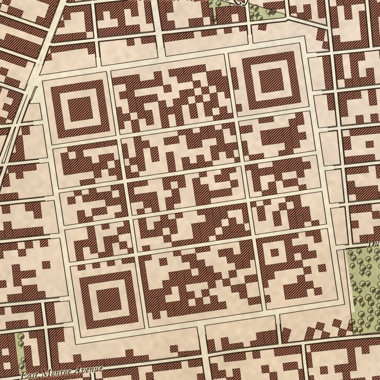
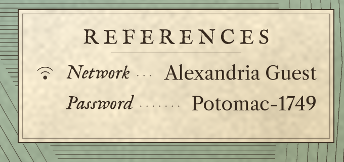
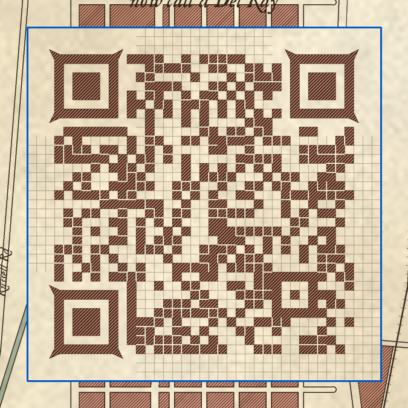

# Wi-Fi QR colonial map

A reproducible pipeline that prints your guest Wi-Fi as a **12 × 12 in, 18th-century
style plan of Alexandria**: Old Town, Rosemont, and Del Ray (the former Town of
Potomac). The QR code is **hidden in the map** as a few made-up blocks of Del Ray. Every
block on the map is drawn as house plots the size of one QR module, and in the hidden
blocks a house is a dark module and an empty plot a light one. The finder patterns are
courtyard blocks, a building type that turns up elsewhere in town too. A table of
references in the river gives the network name and password, with a small Wi-Fi mark,
for any device that can't scan. The network name follows lettered entries for real
buildings on the sheet (Carlyle House, Christ Church…), keyed to letters on the map,
with only the Wi-Fi mark where a letter would be. The password stands alone at the
foot of the table with no label, so nothing on the sheet says "password". Every build is checked by decoders before it counts as done.

Alexandria is only the default. Set any centre point in `config.yaml` to map somewhere
else (see [Mapping another place](#mapping-another-place)).


| The hidden ward at 1:1 (300 dpi) | Legend at 1:1 | Validator's module check |
|---|---|---|
|  |  |  |

The demo uses dummy credentials (`Alexandria Guest` / `Potomac-1749`) and the
OpenStreetMap data from `make fetch`.

## Quick start

```sh
make venv            # .venv with pinned deps (segno, pillow, numpy, opencv-contrib, zxing-cpp, shapely, pyyaml)
make fetch           # one-off per location: OpenStreetMap extract -> data/osm-<name>-<hash>.json
make demo            # dummy credentials -> build/, then validate
cp wifi.env.example wifi.env && $EDITOR wifi.env
make build           # your network (or: WIFI_PASSWORD=... make build ARGS="--ssid MyGuest")
# bigger print with a 3 in wrap border (fetch the larger area first):
#   make fetch build ARGS="--size 24x36 --border 3"
make proof           # 8 x 8 in PDF of the sheet, for a cheap test print
```

`make build` exits non-zero if validation fails. The password is never accepted as a
command-line flag. It comes from `$WIFI_PASSWORD`, the gitignored `wifi.env`, or a
prompt, and it is masked in every log and report. The printed legend shows it on
purpose, unlabelled at the foot of the table; to leave it off, use
`--no-legend-password` or `--legend-password-text "ask at the bar"`. Open networks
print no password line.

### Options (`make build ARGS="..."`)

| Option | Default | Effect |
|---|---|---|
| `--center LAT,LON` | `ward.center` in `config.yaml` | Where the hidden ward sits |
| `--angle DEG` | `ward.angle` in `config.yaml` (`auto`) | Rotate the ward. `auto` follows the nearest major street. |
| `--size WxH` | `print.size` in `config.yaml` (`12x12`) | Print size in inches, e.g. `16x20`, `24x36`. The map fills the sheet inside the border at the 12 in design's scale for the short side, scaled up with the sheet, so a longer sheet shows more ground along its long side. Each size needs its own `make fetch ARGS="--size ..."` (same flags). |
| `--border IN` | `print.border` (`0`) | Blank parchment border on all sides, for a canvas wrap or mat |
| `--module-in IN` | `0.05` | Printed module and house-plot size. Bigger is easier to scan; the map's scale stays the same. |
| `--ecc l/m/q/h` | `q` | Error correction. Higher means more modules, so a bigger ward. |
| `--version N` | smallest that fits | Force more modules, so more blocks in the ward |
| `--legend-network-text` / `--legend-password-text` | SSID / password | Legend text (printed without labels) |
| `--no-legend-password`, `--no-legend` | | Omit the password line, or the whole legend |

Location, title, ward and legend position, landmarks, hills and place labels are set in
`config.yaml`. Plot size, house density, hatch pitch, street widths, tones, legend text
size, palette and layout are in `qrmap/config.py`. Legend text can also be set
through `WIFI_LEGEND_*` in `wifi.env`.

## Outputs (`build/`, gitignored)

| File | What it is |
|---|---|
| `wifi-map.png` | Final art; 3600 × 3600 px at the default 12 × 12 in, 300 dpi (pHYs set) |
| `wifi-map.pdf` | Same, on a page of the print size, for the print shop |
| `ward-detail.png` | Crop of the hidden ward at 1:1 |
| `artwork.svg` | Inkscape master: the final raster, plus hidden layers with the vector QR reference and the quiet-zone outline |
| `qr-reference.svg` | The plain QR code, for comparison |
| `manifest.json` | Version, mask, ward placement, module matrix, and the payload's SHA-256 (not the password) |
| `validation.json`, `*-module-check.png` | Validator report, plus a ward close-up with any wrong modules boxed in red |

## How the code is hidden

```
credentials ─► Segno WIFI: payload (ECC Q) ─► of 8 valid masks, keep the most town-like
OSM extract ─► shapely blocks, cut back from every road ─► each block laid out in plots
               one module wide: house (dark) or yard (light)
                                       │  the ward replaces the blocks under it:
                                       ▼
   dark module  → house: carmine wash, 45° hatching, ink outline, some party walls
   light module → empty plot: the same pale yard wash as every other yard
   every ~6 / 12 modules → a narrow street along module edges, splitting the ward
                           into blocks that run the same way as the town's
   finder       → courtyard block: terraced ring, court, hall in the middle
   quiet zone   → front gardens, a street round the ward, the neighbours' back yards
                                       │
          references + Wi-Fi rows, letters on the map · guard pass · frame ─► validate
```

- **One plot size for the whole town.** The scale is fixed so that a house plot on the
  map (16 m of frontage) prints the same size as a QR module (0.05 in). Every block is
  divided into plots on a lattice turned to its own long side. Plots on the street
  front are mostly built and plots behind them mostly yards. The ward's mix of houses
  and empty plots is the same mix, in the same ink, so it reads as more of the town.
- **Streets on module edges.** The ward's streets run between modules, never through
  a module centre, and never through a finder or alignment pattern. Its blocks are
  about 6 by 12 modules, running the way the blocks around it do. The whole ward is
  turned to the nearest major street (`ward.angle: auto`).
- **Courts.** A few big blocks elsewhere in town are built as courts round a hall, so
  the three finder patterns are one more of a kind. Their proportions are never
  1:1:3:1:1 both ways (big courts have a 3-plot yard round one building, long ones a
  long hall), so finder-pattern detectors don't take them for finders. None is placed
  within a ward's width of the code.
- **Quiet zone.** The neighbouring blocks run up to a street round the ward and keep
  their part inside the quiet zone as back yards with no houses. The real streets stop
  at the yards.
- **Town-like mask.** Of the eight masks, which are all equally valid, the build
  keeps the one where houses most often join their neighbours into terraces.
- **Guard pass.** After rendering, any module centre that lands on the wrong side of
  the light/dark targets is pulled back. With the defaults it corrects 0 modules.
- **ECC Q instead of H.** The modules are drawn cleanly rather than damaged by art,
  so a lower error-correction level is enough. That keeps the ward small: the demo
  payload is version 4, 33 × 33 modules, 1.65 in square.
- **A real table of references.** Engraved plans keyed their notable buildings to
  letters in a table. The cartouche does the same with up to six real named buildings
  from OSM inside the sheet. Configured landmarks come first, then historic and civic
  buildings, markets and museums, churches, then stations. Within each kind, shorter
  names win, and the picks are spread apart and kept off the ward and the cartouche.
  Each gets an engraved letter on the map (beside its symbol, if it is a landmark),
  lettered north to south. The network name follows in the same type and leaders,
  keyed by the Wi-Fi mark instead of a letter, and the password closes the table on
  its own line. Set `references:` in `config.yaml` to list your own (`{at: [lat, lon],
  text: ...}`) or `[]` for none.
- **Deterministic.** Every random choice (which plots are built, party walls, courts)
  comes from a fixed seed, so the same inputs give a byte-identical sheet.

## Validation (`make validate IMAGE=...`)

Run this on whatever you'll actually print, including files you've edited by hand in
GIMP or Inkscape. The `manifest.json` from the build has to sit next to the image.

1. **Print geometry.** The image is 3600 × 3600 px with 300 dpi metadata, and the
   PDF MediaBox is 12 × 12 in.
2. **Module fidelity.** A lattice over the central 30% of every module is sampled,
   following the ward's rotation. Gate: zero errors, and at least 60 grey levels
   between the lightest dark centre and the darkest light centre. The report also
   gives the quiet zone's mean tone and a defocus error rate.
3. **Decoder battery.** ZXing-C++ and three OpenCV detectors, including WeChat, are
   run on 17 captures:
   - the whole sheet at 3600, 2400, and 1500 px
   - close-ups framing the ward, as a phone held 15–30 cm away would, at 1400, 900,
     600, and 400 px
   - close-ups with rotation, 6% and 10% perspective, blur, sensor noise, JPEG q35,
     glare, low light, and a combined capture

   Gates: every clean capture must be read by at least 2 decoders, and ZXing must read
   at least 80% of the stressed ones. Decoded text must hash to the manifest's SHA-256.

Results:
- **Demo:** 0 / 1089 centre errors, contrast margin 102, 17 / 17 captures read by
  ZXing and WeChat, guard corrections 0.
- **Version 7** (`--version 7`, 45 × 45 modules with six alignment patterns) passes too.
- **The offline schematic** (no OSM cache) passes too.
- **Plain `cv2.QRCodeDetector`:** misses some captures, so it doesn't gate the build.

**A desktop pass is necessary but not sufficient.** At 0.05 in per module, this code is
meant to be scanned up close, about 15–30 cm away, which suits "the code is hidden in
the map". Before ordering the 12 in print:
- Print `make proof`. It's scaled to 8 in, so the modules print smaller than the real
  sheet's, which makes it a conservative test.
- Test with the iPhone Camera app and an Android camera, under the light where the
  print will hang, and behind the glass if it will be framed. Matte glass or no glass
  is easiest to scan.
- If scanning is fussy, raise `--module-in` to 0.06–0.07, or shorten the password.

## Mapping another place

The map covers a square around a centre point. The scale is fixed, because a house plot
has to print the same size as a QR module, so the sheet always shows about a mile
from the centre to each edge. A minimal `config.yaml` is just:

```yaml
name: Annapolis
center: [38.9784, -76.4922]
```

Then run `make fetch demo`. To keep several places side by side, give each its own
file and pass it to every target: `make fetch demo CONFIG=places/annapolis.yaml`.

With only those two keys:
- **Title:** `A PLAN of ANNAPOLIS`, with no subtitle.
- **Hidden ward:** sits at the map centre, turned to the nearest major street. Set
  `ward.center` to move it off your house, and `ward.angle` to a number of degrees to
  turn it yourself.
- **Legend:** goes in the lower-left corner. Open water is the traditional spot, if the
  map has any (`legend.center`). Its references are picked from the named buildings
  OSM has there.
- **Place names:** come from OSM, ranked from city down to hamlet and placed away from
  the border. Large named waters are labelled at their widest point. A `labels:` list
  replaces them all with your own (see the Alexandria config). Labels get a knock-out
  halo so they stay legible over houses.
- **Landmarks and hills:** none, unless listed under `landmarks:` (by exact OSM name)
  and `hills:`.

Older configs with `radius_miles` are rejected with a message saying to remove it.

## Map data and accuracy

- **`make fetch`** pulls roads, rail, water (including coastline handling), parks,
  place names, landmark positions, and named buildings for the references (churches,
  town hall, courthouse, market, museums, historic buildings, stations) for the
  `config.yaml` area from the Overpass API,
  and caches them in `data/`. The cache file name includes a hash of the query, so
  changing the location or landmarks never reuses stale data; builds stop and ask for
  `make fetch` instead. Commit the cache file if you want reproducible builds.
  Data © OpenStreetMap contributors, ODbL. The attribution is printed in the lower border.
- **Without a cache**, Alexandria's config (`offline_fallback: alexandria`) falls back to
  a hand-plotted schematic (`qrmap/seed.py`). Old Town's grid is generated from its real
  street order, spacing, and ~9° skew, and the shoreline and arterials come from known
  landmarks. Del Ray's grid spacing and Rosemont's lanes are schematic, so treat that
  version as a layout proof, not a map. Other locations have no fallback.
- **The houses are invented.** Building positions are not taken from OSM: every block
  is filled with plots from a seeded random draw. Streets, blocks, water and parks are
  real.
- **The ward is invented on purpose.** It replaces whatever real streets lie under its
  footprint.
- **Period detail is styling, not history.** In the 18th century, only Old Town
  (the 1749 town) existed. Del Ray and St. Elmo date from 1894, and the Town of
  Potomac was incorporated in 1908 and annexed in 1930. Hence the title's "the late
  Town of Potomac".

## Notes on the original LLM write-up

The overall approach held up: Segno, the matrix as a fixed binary mask, and validate
then print then rescan. These corrections came out of building it:

- Segno escapes `\ ; : "` in Wi-Fi payloads but not commas, and that's fine: commas
  aren't delimiters in `WIFI:` strings. Use `T:WPA` for WPA2, WPA3-transition, and
  mixed networks. Use `SAE` only for WPA3-only networks, and test those phones.
- Decoders see only lightness, so hue is free. Texture added in GIMP afterwards can
  change lightness, so re-run `make validate` on the edited file.
- `cv2.QRCodeDetector.detectAndDecode` alone is a poor gate for artistic QR codes.
  It fails renders that phones read. Gate on ZXing and WeChat as well.
- Mask choice is free, and all eight masks are equally valid. Picking the one that
  best suits the art is a cheap win the write-up didn't mention.
- A short guest SSID and password lower the QR version, which gives a smaller, better
  hidden ward.

## Layout

```
config.yaml          location (centre), title, ward and legend position, labels
qrmap/config.py      loads config.yaml; fixed scale and physical tunables (plots, hatching, palette, layout)
qrmap/geo.py         projection + GeoModel (blocks are faces of the street network, cut back from the roads)
qrmap/osm.py         Overpass fetch + OSM → GeoModel, place labels
qrmap/seed.py        hand-plotted Alexandria fallback geography
qrmap/render_map.py  engraved map art
qrmap/houses.py      house plots in every block, courts, and the shared house finish
qrmap/ward.py        the hidden QR ward (house blocks), legend cartouche, Wi-Fi mark
qrmap/district.py    ward placement, auto angle, module <-> pixel transform (shared with validator)
qrmap/guard.py       module-centre safety pass
qrmap/qr.py          Wi-Fi payload, matrix, town-like mask choice
qrmap/frame.py       graduated neat line, title, scale, attribution
qrmap/validate.py    acceptance tests (exit code gates the build)
qrmap/build.py       CLI
fonts/               IM Fell English + Libre Caslon Text (SIL OFL) via @fontsource
```
