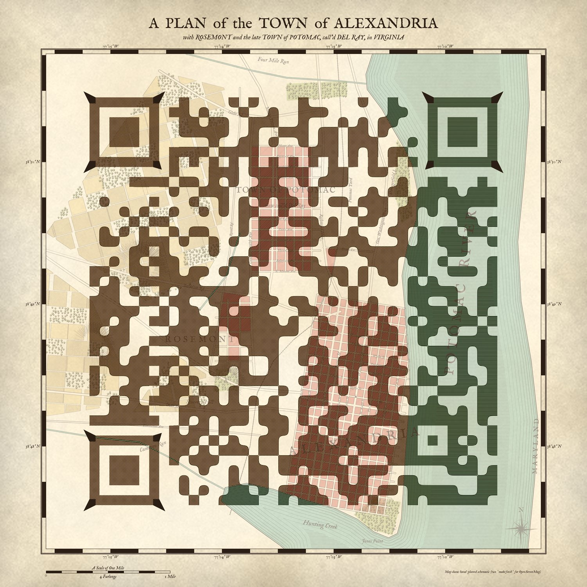
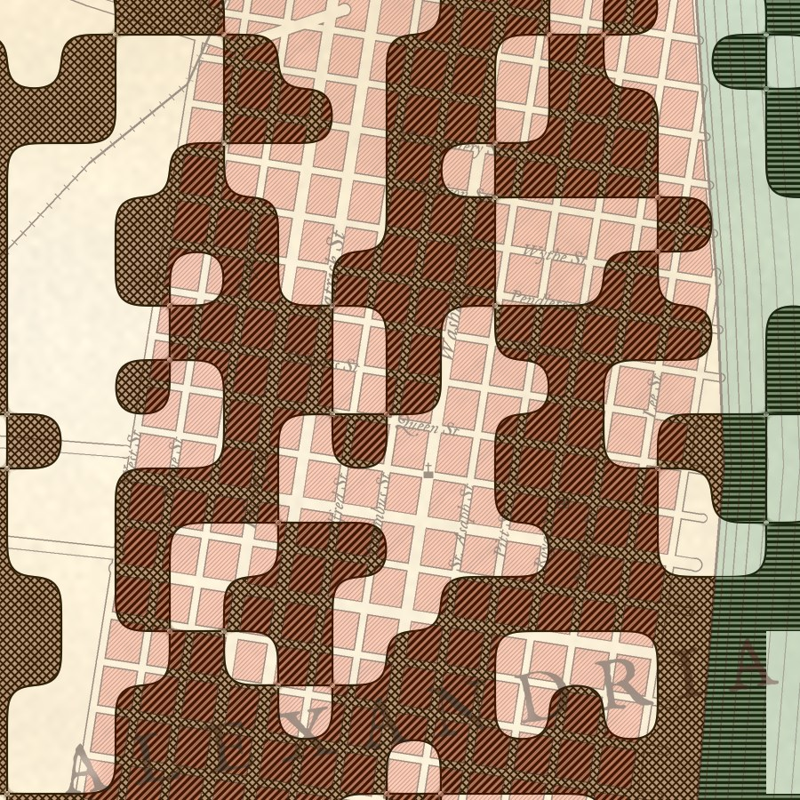
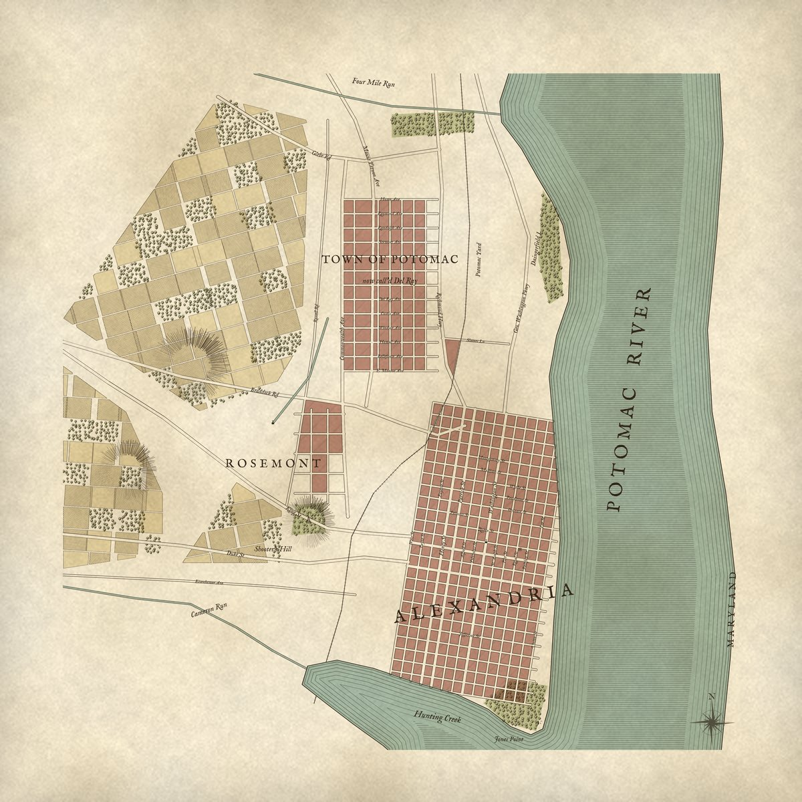
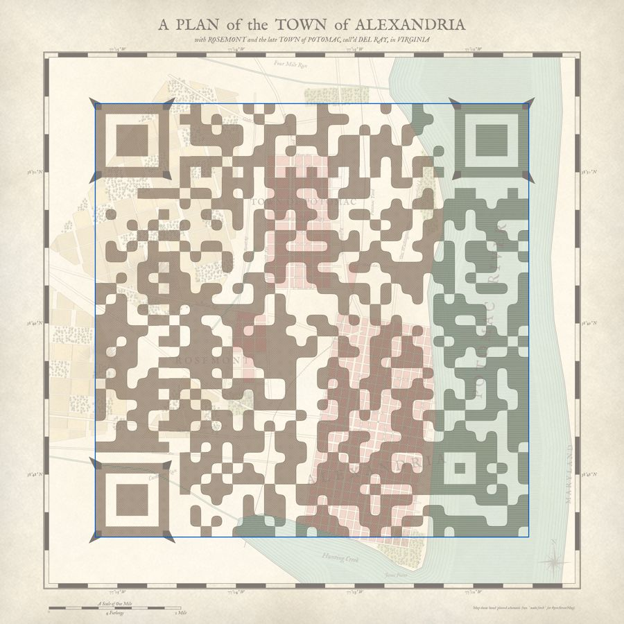

# Wi-Fi QR colonial map

A reproducible pipeline that prints your guest Wi-Fi as a **12 × 12 in, 18th-century
style plan of Alexandria**: Old Town, Rosemont, and Del Ray (the former Town of
Potomac). The QR symbol is engraved into the map rather than pasted over it, and every
build is checked by decoders before it counts as done.



| 1:1 detail at 300 dpi | Map layer with no QR | Validator's module check |
|---|---|---|
|  |  |  |

The demo uses dummy credentials (`Alexandria Guest` / `Potomac-1749`). Point a phone
camera at the preview on screen and it should offer to join that network.

## Quick start

```sh
make venv            # .venv with pinned deps (segno, pillow, numpy, opencv-contrib, zxing-cpp, shapely)
make fetch           # one-off: OpenStreetMap extract -> data/osm-alexandria.json (needs internet)
make demo            # dummy credentials -> build/, then validate
cp wifi.env.example wifi.env && $EDITOR wifi.env
make build           # your network (or: WIFI_PASSWORD=... make build ARGS="--ssid MyGuest")
make proof           # 8 x 8 in PDF for a cheap test print on letter paper
```

`make build` exits non-zero if validation fails. The password is never accepted as
a command-line flag. It comes from `$WIFI_PASSWORD`, the gitignored `wifi.env`, or a
prompt, and it is masked in every log and report.

## Outputs (`build/`, gitignored)

| File | What it is |
|---|---|
| `wifi-map-12in.png` | Final art, 3600 × 3600 px, 300 dpi (pHYs set) |
| `wifi-map-12in.pdf` | Same, on a 12 × 12 in page, for the print shop |
| `artwork.svg` | Inkscape master: final raster, map-only raster, vector QR reference, and module grid as layers |
| `layers/map.png` | The map before the QR is applied, for GIMP work |
| `layers/qr-tone-target.png` | Where the compositor wants dark and light |
| `qr-reference.svg` | Plain QR with a 4-module quiet zone, for comparison |
| `manifest.json` | Version, mask, geometry, module matrix, and the payload's SHA-256 (not the password) |
| `validation.json`, `*-module-check.png` | Validator report, plus an overlay marking any wrong modules in red |

## How it works

```
credentials ─► Segno: WIFI: payload, ECC level H ─► version n, 8 candidate masks
OSM extract ─► shapely geometry ─► engraved map art (Pillow/OpenCV, 2× supersampled)
                                        │
            choose the mask whose dark modules best overlap dark map areas
                                        │
                 compose: tone-map every module (below) ─► frame, title, scale
                                        │
                 validate: print size · module centres · decoder battery
```

**The QR is a tone mask, not an overlay.** In CIE L\* space, every pixel keeps the
map's hue, chroma, and line work, and only its lightness is constrained:

- **Light modules** show the map, remapped into L\* 52–100.
- **Dark modules** are cut as dense engraved hatching, and the hatch follows the
  feature underneath: horizontal water-ruling on the river, 45° hatching on town
  blocks, crosshatch on open ground. Up close, the streets still show through it.
  At camera resolution, the hatching averages to a dark module.
- **Neighbouring dark data modules** merge into rounded, ink-ruled "parcels".
- **Finder, timing, and alignment patterns** stay crisp. The three finders are
  drawn as redoubts with corner bastions. The bastions only reach into corners that
  no finder scan line crosses, and the one facing the symbol is kept short so the
  separator module's centre stays light.
- **Module centres** (the central 36%, where decoders sample) are corrected only
  when the art leaves them short of the target, so the correction is invisible where
  the art already agrees.
- **The quiet zone** is four modules of the same lightened map. The compass rose
  sits in its lower-right corner, the one corner with no finder pattern.

Every look-and-feel knob lives in `qrmap/config.py`: tone bands, hatch pitch, core
size, parcel softness, palette, and layout.

## Validation (`make validate IMAGE=...`)

Run this on whatever you'll actually print, including files you've edited by hand in
GIMP or Inkscape. The `manifest.json` from the build has to sit next to the image.

1. **Print geometry.** The image is 3600 × 3600 px with 300 dpi metadata, and the
   PDF MediaBox is 12 × 12 in.
2. **Module fidelity.** Each module's central 30% is sampled. Gate: zero centre
   errors, and at least 60 grey levels between the lightest dark core and the darkest
   light core. The report also gives the error rate a badly defocused camera would see.
3. **Decoder battery.** ZXing-C++ (the decoder family in many Android scanners),
   OpenCV's WeChat detector, and two other OpenCV detectors are run on:
   - clean captures at full resolution, 1600, 1000, and 640 px
   - stressed captures: 17° rotation, 6% and 10% perspective, blur, sensor noise,
     JPEG q35, glare, low light, 480 px, and a combined
     perspective + blur + noise + JPEG capture

   Gates: every clean capture must be read by at least 2 decoders, and ZXing must read
   at least 80% of the stressed ones. Decoded text must hash to the manifest's SHA-256.

Current demo: 0 / 1681 centre errors, contrast margin 101, 15 / 15 captures read by
ZXing and WeChat. The longer payloads I tried (version 8, and version 10 forced) pass
too. The plain `cv2.QRCodeDetector` misses many captures of textured art. That's a
known weakness of that detector, which is why it isn't one of the gating decoders.

**A desktop pass is necessary but not sufficient.** Before ordering the 12 in print:
print `make proof`, then test the iPhone Camera app and an Android camera at 2, 4, and
6 ft, under the light where the print will hang, and behind the glass if it will be
framed. Matte glass or no glass is much easier to scan than glossy. A 12 in print gives
a ~8.3 in symbol with 0.2 in modules, comfortably in range at 4–6 ft.

## Map data and accuracy

- **`make fetch`** pulls roads, rail, water (including coastline handling), parks,
  and landmark positions for the bounding box in `qrmap/config.py` from the
  Overpass API, and caches them in `data/`. Builds use the cache automatically.
  Data © OpenStreetMap contributors, ODbL. The attribution is printed in the lower
  border.
- **Without the cache**, a hand-plotted fallback (`qrmap/seed.py`) is used. Old Town's
  grid is generated from its real street order, spacing, and ~9° skew, and the
  shoreline and arterials come from known landmarks. Del Ray's grid spacing and
  Rosemont's lanes are schematic, so treat that version as a layout proof, not a map.
  The demo images above use the fallback, because the build sandbox couldn't reach
  OSM. After `make fetch`, commit `data/osm-alexandria.json` so builds stay reproducible.
- **Period detail is styling, not history.** In the 18th century, only Old Town
  (the 1749 town) existed. Del Ray and St. Elmo date from 1894, and the Town of
  Potomac was incorporated in 1908 and annexed in 1930. Hence the title's "the late
  Town of Potomac".

## Notes on the original LLM write-up

The overall approach held up: Segno, the matrix as a fixed binary mask, and validate
then print then rescan. These corrections came out of building it:

- Segno escapes `\ ; : "` in Wi-Fi payloads but not commas, and that's fine: commas
  aren't delimiters in `WIFI:` strings. Use `T:WPA` for WPA2, WPA3-transition, and
  mixed networks. Use `SAE` only for WPA3-only networks, and test those phones.
- The best-looking path is not "QR layer above GIMP texture". Hue is free, because
  decoders see luminance, so the QR is applied as a lightness constraint on the
  finished colour art. Texture added in GIMP afterwards can change lightness, so
  re-run `make validate` on the edited file.
- `cv2.QRCodeDetector.detectAndDecode` alone is a poor gate for artistic QR codes.
  It fails clean renders that phones read. Gate on ZXing and WeChat as well.
- Mask choice is free, and all eight masks are equally valid. Picking the one that
  best matches the art is a cheap win the write-up didn't mention.
- A shorter guest SSID and password lower the QR version, which gives bigger modules
  and more forgiving scanning. A 45-character payload is version 6 (41 modules).

## Layout

```
qrmap/config.py      tunables (bbox, layout, palette, tone bands)
qrmap/geo.py         projection + GeoModel (blocks are faces of the street network)
qrmap/osm.py         Overpass fetch + OSM → GeoModel
qrmap/seed.py        hand-plotted fallback geography + place labels
qrmap/render_map.py  engraved map art
qrmap/qr.py          Wi-Fi payload, matrix, art-aware mask choice
qrmap/compose.py     QR-guided tone mapping, parcels, redoubts
qrmap/frame.py       graduated neat line, title, scale, attribution
qrmap/validate.py    acceptance tests (exit code gates the build)
qrmap/build.py       CLI
fonts/               IM Fell English (SIL OFL, fonts/OFL.txt) via @fontsource
```
